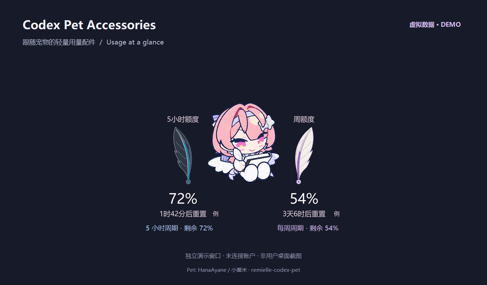
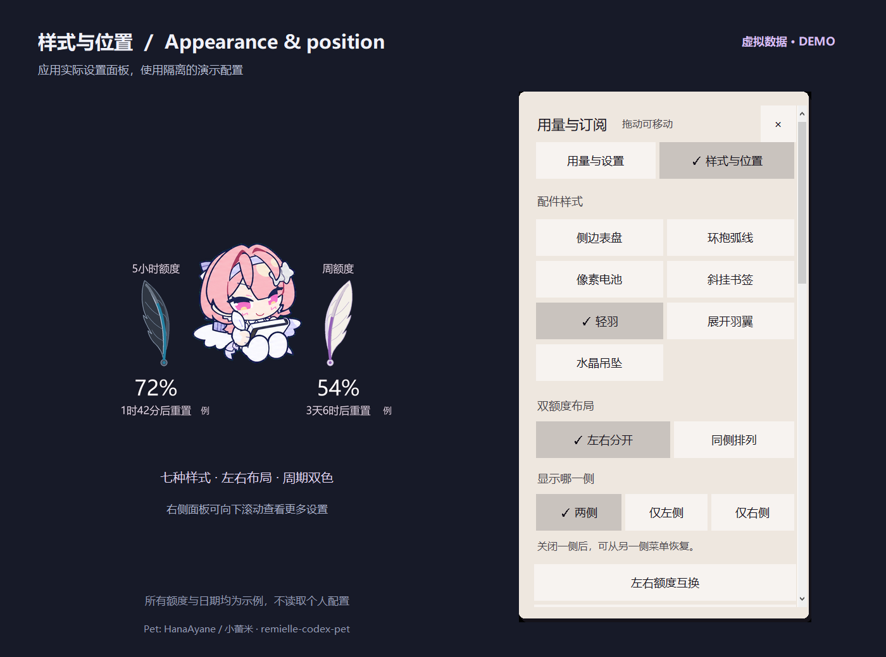

# Codex Pet Accessories

[简体中文](README.md) | **English**

A lightweight Windows companion that displays Codex usage limits and reset times beside your desktop pet. Choose a feather, dial, or another small accessory and let it follow the pet as it moves.

This is an independent community application, not an official OpenAI product or a plugin installed through the Codex plugin marketplace. It does not modify Codex or replace your pet. The portable application contains no pet artwork; the demonstrations below use a credited public reference pet.



This demonstration was generated in a separate window with synthetic usage data. It is not a screenshot of the author's desktop. The reference pet is Remielle Codex Pet by HanaAyane / 小蕾米; original sources and usage terms are credited at the end of this guide.

**[Download the Windows portable edition — no Python installation](https://github.com/am-q/codex-pet-accessories/releases/download/v0.3.0/codex-pet-accessories-0.3.0-windows-x64.zip)** · [Release page](https://github.com/am-q/codex-pet-accessories/releases/latest)

## Features

- Seven styles: dial, arc, pixel battery, bookmark, feather, wings, and crystal.
- Remaining usage percentage and reset countdown, with explicit states for unknown data and query failures.
- Colors identify usage periods: blue and black feathers for shorter periods; purple and white feathers for longer periods. A theme-based color option is also available.
- Feather progress follows the quill; wing progress follows the wing root. The outlines remain complete as usage changes.
- Position accessories on the left, right, or automatically beside the pet, with fallback placement near screen edges.
- Show two usage periods on separate sides, keep only one side visible, swap periods, or mirror accessory shapes while keeping text readable.
- Compact, standard, and wide spacing based on the visible artwork.
- Six color themes, custom colors, light or dark text, and standard or compact information density.
- A draggable, scrollable details menu with full reset times, update status, and plan information returned by the local interface.
- An optional renewal-date reminder entered manually. Billing renewal dates are not retrieved automatically.

## Requirements

- Windows 10 or Windows 11, 64-bit x64, with an interactive desktop session.
- The portable edition includes Python, Tcl/Tk, and Pillow. You do not need to install Python.
- The Codex desktop application installed and signed in, with a desktop pet visible.
- A working local `codex app-server --stdio` command. The application checks PATH first, then `%LOCALAPPDATA%\OpenAI\Codex\bin\*\codex.exe`.

## Download and double-click to start

1. [Download the Windows x64 portable ZIP](https://github.com/am-q/codex-pet-accessories/releases/download/v0.3.0/codex-pet-accessories-0.3.0-windows-x64.zip).
2. **Extract the entire ZIP** to a folder.
3. Open Codex, sign in, and show your desktop pet.
4. Double-click **CodexPetAccessories.exe**. Click or right-click an accessory for settings, and exit from its menu.

No setup script or separate Python installation is needed. Keep the application folder in place if automatic startup is enabled; disable that setting before moving the folder. Exit an older copy before upgrading.

Install your desktop pet separately; its original sources are credited below. The [release page](https://github.com/am-q/codex-pet-accessories/releases/latest) also provides the source archive and SHA256 checksums.

## Interface preview



The right side shows the application's actual **样式与位置** (Appearance and position) panel. Scroll it for more options. Usage, plan, and date values are examples; screenshot generation does not read personal settings, account data, or real pet state. See [Demonstration sources](docs/SCREENSHOT_SOURCES.md) for the generation method and pinned asset version. The UI currently uses Chinese; English menu explanations are included below.


## Source installation (optional, for developers)

Portable users can skip this section. [Download the current source ZIP](https://github.com/am-q/codex-pet-accessories/archive/refs/heads/main.zip), or choose **Code → Download ZIP**. The source edition needs Python 3.12 or later with Tcl/Tk and Pillow 12.3.0. Python 3.12 is the tested version.

Open PowerShell in the extracted project folder and run:

```powershell
.\Install.ps1
```

The installer creates a project-specific `.venv` environment and installs its dependencies. It does not change the system execution policy, enable automatic startup, or save login tokens. A current-user scheduled task is created only if you later enable automatic startup in the application.

Alternatively, install the dependencies manually:

```powershell
py -3 -m venv .venv
.\.venv\Scripts\python.exe -m pip install -r requirements.txt
```

Double-click **Launch.vbs** to start. Double-click **Stop.vbs**, or choose Exit in the accessory menu, to stop it. If VBScript is unavailable, start the application directly:

```powershell
.\.venv\Scripts\pythonw.exe .\src\pet_base.py
```

Exit an older copy before upgrading. A fresh installation uses its own default settings and does not include the author's usage cache or preferences.

## Use

The application's menus currently use Chinese labels; their meanings are included below.

1. Show your Codex desktop pet, then launch the accessory.
2. Click or right-click an accessory and open **样式与位置** (Appearance and position) to choose its style, placement, and spacing. Changes are saved automatically.
3. Light text suits a dark desktop background. Choose dark text for a light background.
4. Drag your pet to move the accessories with it. Turn off **锁定跟随宠物** (Lock to pet) to drag the accessories independently.
5. Standard mode sorts usage periods of the same category by duration, normally placing the shorter period on the left and the longer period on the right. When only one period is returned, only that period is shown.
6. Choose **两侧／仅左侧／仅右侧** (Both sides / Left only / Right only). A hidden side can be restored from the visible side's menu. **左右额度互换** swaps the periods; **镜像配饰朝向** mirrors directional artwork without mirroring text.
7. **同侧排列** places the accessories together. Near a screen edge, split accessories try to move to a side with enough room. A side you explicitly disabled stays disabled. Compact mode shows a single period.

When neither side has enough safe space, the accessories temporarily hide. Move the pet into an area with more space to restore them. Codex controls the pet, notifications, and native buttons; unusual animations or future Codex versions may need additional compatibility work.

All graphical progress indicators represent remaining usage. Orange markers appear at 20% or below, and red markers at 10% or below. These markers do not replace the period's identifying color. A weekly-only period keeps its purple color and white feather even when moved to the left.

Both accessory windows share the same data, timer, and query thread. Showing a second side does not add usage queries. When detached from the pet, dragging either accessory moves both together.

## Start and stop with your pet

In **用量与设置** (Usage and settings), enable **随宠物自动启停** (Start and stop with pet). This setting is separate from position tracking.

- The accessory starts only while both Codex and its pet are open, usually within one minute. It also works after signing back into Windows.
- Closing the pet exits the accessory after approximately two seconds. Exiting Codex closes it at the next process check, approximately five seconds later. The accessory cancels and cleans up its own usage-query processes.
- Choosing **退出并停用自动启停** (Exit and disable automatic startup), or running Stop.vbs, disables automatic startup and exits. Turning off only the startup setting leaves the current accessory running.
- Windows stores a `CodexPetAccessories-…` scheduled task for the current user, without administrator privileges. It performs a short check each minute while the accessory is stopped; there is no additional persistent supervisor process. The task can appear as Running while the accessory it launched is active.
- After an unexpected exit, the next check can restart the accessory if automatic startup remains enabled and the pet is still open. Disabling this feature removes its scheduled task.

Automatic startup is off by default. Settings and logs are retained when the accessory closes. `lifecycle.log` records normal startup and exit events; `runtime.json` updates approximately every 30 seconds. Python exceptions go to `error.log`, and native crash diagnostics go to `native-crash.log` when available. Forced termination may leave no precise exit reason.

## Query frequency and local data

The default query interval is **five minutes**, with one-minute and fifteen-minute options. Failed queries back off up to 30 minutes. Manual refreshes have a 30-second cooldown, and another query is made after a usage period resets. Countdowns and position tracking update locally.

The application uses only the local Codex app-server messages `initialize`, `initialized`, and `account/rateLimits/read`. It does not create conversations or request model inference. Usage queries still need a network connection, and service availability can change.

Local data is stored in:

```text
%LOCALAPPDATA%\CodexPetAccessories\
  settings.json     Appearance, query interval, manual renewal reminder
  usage.json        Last successful usage response
  startup.json      Startup and window information
  runtime.json      Current state and exit reason
  lifecycle.log     Startup, exit, and settings events
  error.log         Python error diagnostics
  native-crash.log  Native crash diagnostics; may be empty
```

Authentication is handled by the local Codex process. The accessory does not directly read or copy login tokens. Pet tracking reads `%CODEX_HOME%\.codex-global-state.json`, or the user's `.codex` directory when CODEX_HOME is unset, and observes local window positions and mouse dragging. It does not upload desktop screenshots.

`examples/settings.example.json` contains default settings without personal data. Review and redact local data before attaching diagnostics to an issue, since logs can contain local paths.

## Development and verification

```powershell
.\.venv\Scripts\python.exe -m unittest discover -s tests -v
.\.venv\Scripts\python.exe .\src\pet_base.py --demo
.\.venv\Scripts\python.exe .\src\pet_base.py --smoke
```

Demo mode and smoke checks use simulated usage without reading personal settings or querying an account; ordinary unit tests do not access accounts either. GUI checks need a Windows desktop session. [GitHub Actions](https://github.com/am-q/codex-pet-accessories/actions) runs unit tests, Windows GUI regressions, and packaging. Portable releases are also extracted and launched with Python environment variables removed and Python absent from PATH to verify the actual ZIP.

Tests cover usage parsing, retry backoff, menu placement, the seven accessory styles, visible-edge positioning, split layouts, and high-DPI rendering. Mixed-DPI monitors, unusual pet animations, and future Codex versions still need real-world verification.

Additional maintainer documentation is currently in Chinese: [Development](docs/DEVELOPMENT.md), [Releasing](docs/RELEASING.md), and [Changelog](CHANGELOG.md).

## License

The accessory's own code is available under the [MIT License](LICENSE). Dependencies retain their licenses, included in the portable ZIP; see [Third-party notices](THIRD_PARTY_NOTICES.md). The third-party pet character in the demonstration images is excluded from the MIT license. The application does not install a pet.

## Credits and original sources

- **Demonstration and reference pet:** [Remielle Codex Pet / 小蕾米](https://github.com/HanaAyane/remielle-codex-pet), by **HanaAyane / 小蕾米**. Both demonstration images use its public first-frame artwork; see [Demonstration sources](docs/SCREENSHOT_SOURCES.md) for the pinned version. Visit the original project for the pet's downloads and installation instructions.
- **Original character and visual material:** the pet project's [NOTICE.md](https://github.com/HanaAyane/remielle-codex-pet/blob/main/NOTICE.md) credits a [Zenless Zone Zero official event page](https://act.mihoyo.com/zzz/event/e20260717reserve-pvy5cf/index.html) by miHoYo / HoYoverse. The original project describes AI-assisted redrawing, manual organization, and editing of its derived material.
- **Feather appearance:** the accessory's feather is drawn with this project's curve code; its palette and shape also reference the [official Zenless Zone Zero character design page](https://zenless.hoyoverse.com/zh-cn/news/165319).

This repository includes two noncommercial demonstration images containing the public reference pet. The portable application does not bundle character images, GIFs, or sprite sheets. The pet's material is subject to its [ASSET-USAGE.md](https://github.com/HanaAyane/remielle-codex-pet/blob/main/ASSET-USAGE.md) and [NOTICE.md](https://github.com/HanaAyane/remielle-codex-pet/blob/main/NOTICE.md); the accessory's MIT license does not replace those terms or the original rights holders' rights.
