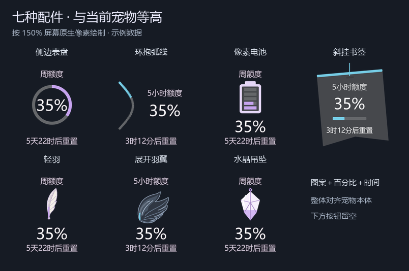

# Codex Pet Accessories

**简体中文** | [English](README.en.md)

Windows 桌面宠物的轻量用量配件：查看 Codex 剩余额度和重置时间，让羽毛、表盘或小饰品跟随宠物移动。

这是独立运行的社区桌面配件，并非 OpenAI 官方产品，也不是通过 Codex 插件市场安装的插件。它不修改 Codex 安装文件、不替换宠物、不包含宠物角色素材。



## 功能

- 七种外观：侧边表盘、环抱弧线、像素电池、斜挂书签、轻羽、展开羽翼、水晶吊坠。
- 剩余百分比与重置倒计时；未知数据、查询失败会明确提示。
- 周期双色：常见短周期用蓝色、黑羽片，长周期用紫色、白羽片；可切换“随主题”保留自定义强调色。
- 轻羽沿羽轴显示进度，展开羽翼沿翼根显示进度；羽片轮廓完整。书签默认两侧下端向外倾斜，文字保持水平。
- 跟随宠物，左侧／右侧／自动位置；边缘空间不足时换侧。
- 双额度默认左右分开；支持仅显示左侧、仅显示右侧、交换左右额度和镜像配饰朝向，文字保持正常。
- 按实际可见内容定位，提供紧凑／标准／宽松三档间距。
- 六种配色、自定义颜色、浅色／深色文字；标准与简洁信息密度。
- 可拖动、可滚动的详情菜单，显示完整重置时间、最近更新、套餐等接口实际返回的信息。
- 续费日期可手动记录；接口未提供自动获取账单续费日期的能力。

## 运行要求

- Windows 10 / 11 桌面会话。目前仅支持 Windows。
- Python 3.12 或更新版本，包含 Tcl/Tk。当前验证环境为 Python 3.12。
- Pillow 12.3.0，安装步骤会从 Python 包索引获取。
- 已安装、登录 Codex 桌面应用，并显示宠物。
- 本机能运行 `codex app-server --stdio`；程序先从 PATH 查找 `codex`，再查找 `%LOCALAPPDATA%\OpenAI\Codex\bin\*\codex.exe`。

## 下载

[下载当前源码 ZIP](https://github.com/am-q/codex-pet-accessories/archive/refs/heads/main.zip)，或在仓库页面选择 **Code → Download ZIP**。解压后进入包含 `Install.ps1` 和 `Launch.vbs` 的项目文件夹。

目前提供需要 Python 的源码版。宠物配件与宠物本体分别安装；宠物原项目和参考来源见本文最后的「致谢与参考来源」。

## 安装和启动

下载或克隆本仓库，在项目目录打开 PowerShell：

```powershell
.\Install.ps1
```

安装会创建项目专用 `.venv` 并安装依赖。安装本身不会修改系统执行策略、加入开机启动或保存登录令牌。启用下述“随宠物自动启停”后，才会为当前用户注册启动检查任务。

若不方便运行安装脚本，可手动执行：

```powershell
py -3 -m venv .venv
.\.venv\Scripts\python.exe -m pip install -r requirements.txt
```

完成后双击 **Launch.vbs**，退出时双击 **Stop.vbs**，也可在配件菜单选择退出。若系统未启用 VBScript，可运行：

```powershell
.\.venv\Scripts\pythonw.exe .\src\pet_base.py
```

升级前退出旧版，避免不同开发版本同时显示。新安装不附带作者的设置或用量缓存。

## 使用

1. 显示 Codex 桌面宠物，再启动配件。
2. 点击或右键配件，进入 **样式与位置** 选择外观、位置和距离。选择自动保存。
3. 默认浅色文字适合深色桌面；浅色桌面可改为深色字。
4. 拖动宠物即可一起移动。取消“锁定跟随宠物”后可单独拖动配件。
5. 标准模式默认将同类额度按周期时长放在左右两侧（通常左侧 5 小时、右侧周额度）。只有一个周期时只显示一个，不补造额度。
6. 在 **样式与位置** 中选择“两侧／仅左侧／仅右侧”；被关闭的一侧可从保留侧菜单恢复。“左右额度互换”改变周期位置，“镜像配饰朝向”改变有方向的图案，书签可切换为朝内；电池、表盘和水晶保持自然方向。
7. 可切回“同侧排列”。靠屏幕边缘时，双侧会尝试合并到可用侧；仍放不下时保留能显示的周期。关闭的侧不会因自动换侧重新出现。简洁模式只显示一个周期。

当两侧都没有足够安全空间时，配件会暂时隐藏；把宠物移到有空间的位置即可恢复。上方通知、宠物及下方按钮的布局由 Codex 控制，特殊动画或未来版本可能需要重新适配。

所有图形进度都表示剩余额度。剩余不超过 20% 时显示橙色提示点，不超过 10% 时显示红色提示点，周期颜色保持不变。只有周额度时保留紫色、白羽片，不会因移到左边而变成短周期配色。

左右配件共用数据、定时器和查询线程。增加一侧不会增加额度查询次数。解除跟随后，拖动任意配件会将两侧一起移动。

## 随宠物自动启停

点击或右键配件，在“用量与设置”中开启 **随宠物自动启停**。它与“锁定跟随宠物”的位置开关独立。

- 开启后，仅在 Codex 桌面程序和宠物都开启时启动配件，通常在一分钟内出现；重新登录 Windows 后也有效。
- 关闭宠物约两秒后退出配件；退出 Codex 后，配件在下一次进程检查时退出（约五秒），并取消和清理自己的额度查询进程树。不会终止 Codex 或其他任务的进程。
- 点击“退出并停用自动启停”或双击 Stop.vbs，会停用自动启动并退出。仅关闭该开关则保留当前配件运行。
- Windows 为当前用户保存一个 `CodexPetAccessories-…` 计划任务，权限为普通用户。配件未运行时每分钟做一次短检查；没有额外常驻守护进程。配件运行期间该任务可以显示为“正在运行”，因为配件本身由它启动。任务不设一小时或三天的运行时限。
- 意外退出后，只要开关仍开启且宠物仍开着，下一次检查会重新启动。停用该开关会删除对应任务。

新安装默认关闭，按需启用。关闭配件保留个人设置及日志。`lifecycle.log` 记录启动和正常退出原因，`runtime.json` 每约 30 秒更新当前状态；Python 异常写入 `error.log`，原生崩溃由 `native-crash.log` 尽力记录。外部强制终止不能保证留下精确原因，不能把缺少退出日志当作已查明原因。

## 查询频率与数据

默认每 **5 分钟**查询一次，可改为 1 或 15 分钟；失败会逐步退避至最多 30 分钟。手动刷新有 30 秒间隔，到重置时间后会补查。倒计时和拖动跟随在本机更新。

程序仅使用本机 Codex app-server 的 `initialize`、`initialized`、`account/rateLimits/read` 消息，不创建对话或发起模型推理调用。额度查询仍需要网络；不承诺服务端接口永远可用或具有固定调用限额。

本机数据默认保存在：

```text
%LOCALAPPDATA%\CodexPetAccessories\
  settings.json   外观、频率、手动续费日期
  usage.json      上次成功查询的额度元数据
  startup.json   启动状态与窗口信息
  runtime.json   当前运行状态与退出原因
  lifecycle.log  启动、退出及设置变更记录
  error.log      出错时的诊断信息
  native-crash.log 原生崩溃诊断（可能为空）
```

程序不直接读取或复制登录令牌，认证由本机 Codex 进程处理。宠物定位会只读访问 `%CODEX_HOME%\.codex-global-state.json`（未配置时为用户目录下 `.codex`），以及本机窗口位置和鼠标拖动状态；不会上传桌面截图。

`examples/settings.example.json` 是不含个人数据的默认配置参考。不要将本机上述数据目录作为 Issue 附件直接上传，诊断日志可能包含本机路径。

## 开发与验证

```powershell
.\.venv\Scripts\python.exe -m unittest discover -s tests -v
.\.venv\Scripts\python.exe .\src\pet_base.py --demo
.\.venv\Scripts\python.exe .\src\pet_base.py --smoke
```

`--demo` 和 `--smoke` 使用模拟用量，不查询账号；普通单元测试也不访问账号。界面检查需要 Windows 桌面会话。[GitHub Actions](https://github.com/am-q/codex-pet-accessories/actions) 会执行单元测试、Windows 界面回归与源码打包；首次仓库上传已通过完整检查，后续结果可在该页面查看。

当前本地测试覆盖额度解析、退避、菜单定位、七种绘制、可见边缘定位、左右换侧和高 DPI 渲染。混合缩放多屏、特殊宠物动画和未来 Codex 版本仍需实际使用检验。

详情见 [开发说明](docs/DEVELOPMENT.md)、[发布说明](docs/RELEASING.md) 与 [更新记录](CHANGELOG.md)。

## 许可

项目自身代码使用 [MIT License](LICENSE)。第三方依赖保留各自许可，见 [第三方说明](THIRD_PARTY_NOTICES.md)。不包含任何宠物角色图片；请自行安装有权使用的宠物素材。

## 致谢与参考来源

- **参考宠物项目**：[Remielle Codex Pet（小蕾米）](https://github.com/HanaAyane/remielle-codex-pet)，作者 **HanaAyane / 小蕾米**。本配件开发时使用、参考了该宠物项目；需要宠物本体时，请前往原项目查看下载与安装说明。
- **原始角色与素材来源**：原宠物项目在其 [NOTICE.md](https://github.com/HanaAyane/remielle-codex-pet/blob/main/NOTICE.md) 中注明，部分素材和动作参考来自米哈游 / HoYoverse 的[《绝区零》官方活动页面](https://act.mihoyo.com/zzz/event/e20260717reserve-pvy5cf/index.html)，并经过 AI 辅助重绘、人工整理与编辑。
- **轻羽外观参考**：本项目的羽毛由曲线代码绘制，配色与形态另参考[《绝区零》官方角色设定页面](https://zenless.hoyoverse.com/zh-cn/news/165319)。

本仓库只提供独立用量配件及模拟数据预览，不打包原宠物的角色图、GIF 或精灵图。原宠物素材的使用范围见其 [ASSET-USAGE.md](https://github.com/HanaAyane/remielle-codex-pet/blob/main/ASSET-USAGE.md) 和 [NOTICE.md](https://github.com/HanaAyane/remielle-codex-pet/blob/main/NOTICE.md)；本配件的 MIT 许可不替代原项目及相关权利人的素材使用条款。
